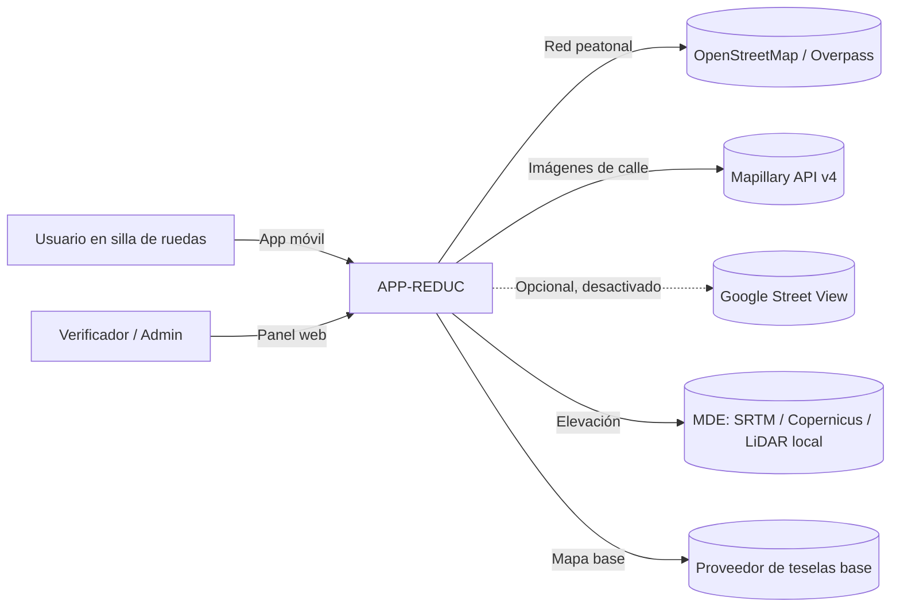
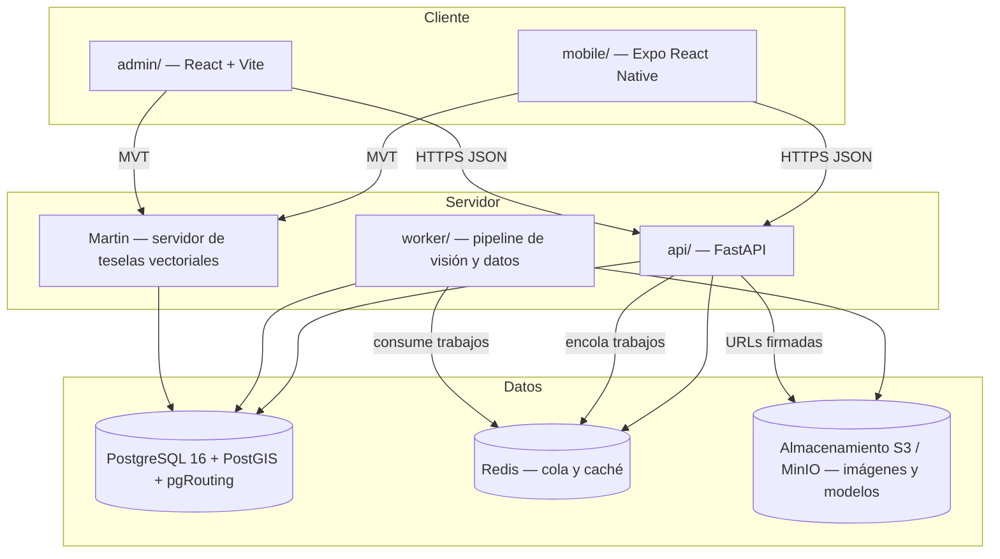
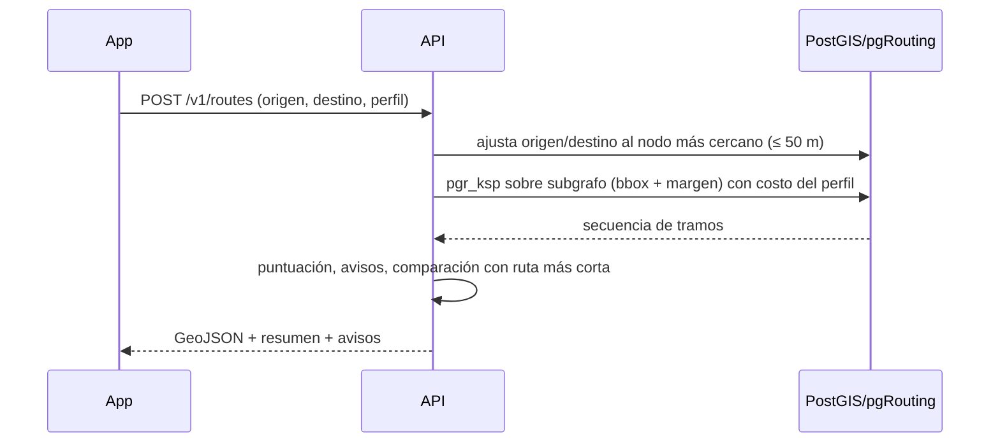

# 02 — Arquitectura

## 1. Principios

1. **La región es un parámetro, no un caso especial.** Nada en el código asume el campus. El campus es la fila `region.slug = 'campus-piloto'`.
2. **Proveedores intercambiables.** Fuentes de imágenes, detectores, fuente de elevación y motor de rutas se usan a través de interfaces (`ImageProvider`, `Detector`, `ElevationSource`, `RoutingEngine`).
3. **Separar "observación" de "hecho".** Una detección del modelo es una *observación* con confianza. La *barrera* es el resultado de fusionar observaciones (y verificaciones humanas). El ruteo solo consume atributos de tramo derivados de barreras.
4. **Seguridad conservadora.** Ante datos dudosos se penaliza, no se ignora. Una barrera crítica confirmada siempre bloquea según el perfil.
5. **Mapa versionado e inmutable una vez publicado.** El ruteo lee una versión publicada; el pipeline escribe una versión nueva en borrador.

## 2. Diagrama de contexto



## 3. Contenedores



| Contenedor | Tecnología | Responsabilidad |
|-----------|-----------|----------------|
| `mobile` | Expo SDK (última estable), TypeScript, `@maplibre/maplibre-react-native`, TanStack Query, Zustand | UI del usuario final, perfiles locales, solicitud y visualización de rutas |
| `admin` | React 18, Vite, TypeScript, MapLibre GL JS, TanStack Query | Regiones, trabajos del pipeline, cola de verificación, subida de fotos |
| `api` | Python 3.12, FastAPI, SQLAlchemy 2 + GeoAlchemy2, Alembic, Pydantic v2 | API REST pública y de administración; orquesta trabajos; ruteo |
| `worker` | Python 3.12, Dramatiq (o RQ) sobre Redis, PyTorch, OpenCV, Shapely, pyproj | Importación OSM, elevación, ingesta de imágenes, inferencia, geolocalización, fusión, cálculo de atributos, publicación |
| `tiles` | Martin (maplibre/martin) | Teselas vectoriales de `edge_accessibility` y `barrier` desde vistas de PostGIS |
| `db` | PostgreSQL 16, PostGIS 3.5, pgRouting 3.7 | Fuente de verdad |
| `redis` | Redis 7 | Cola de trabajos, caché de rutas (TTL corto) |
| `storage` | Almacenamiento compatible con MinIO/S3 (local) / S3 (producción) | Imágenes originales, recortes, pesos de modelos |

`api` y `worker` comparten un paquete Python interno `core/` (dominio, modelos ORM, interfaces), para no duplicar lógica.

## 4. Componentes del backend

```
core/
  domain/         # entidades puras y reglas (perfil, costo, fusión, puntuación)
  db/             # modelos ORM, sesión, repositorios
  providers/
    images/       # ImageProvider: mapillary.py, upload.py, streetview.py
    elevation/    # ElevationSource: raster_file.py (GeoTIFF), opentopo.py
    osm/          # importador de red peatonal (Overpass / archivo .pbf)
  vision/
    detector.py   # interfaz Detector + implementación
    segmenter.py  # segmentación de acera/superficie
    geolocate.py  # proyección de detecciones al mundo
    fusion.py     # agrupación de observaciones en barreras
    privacy.py    # desenfoque de rostros/matrículas
  routing/
    engine.py     # interfaz RoutingEngine
    pgrouting.py  # implementación con pgr_dijkstra / pgr_ksp
    cost.py       # función de costo por perfil
    narrative.py  # avisos e instrucciones por tramo
  pipeline/
    jobs.py       # definición de etapas y su orquestación
```

## 5. Flujos principales

### 5.1 Alta y procesamiento de una región

```mermaid
sequenceDiagram
  participant A as Admin
  participant API
  participant Q as Redis
  participant W as Worker
  participant DB as PostGIS
  A->>API: POST /admin/regions (polígono, fuentes)
  A->>API: POST /admin/regions/{id}/pipeline-runs
  API->>DB: crea map_version (draft) + pipeline_run
  API->>Q: encola etapa import_osm
  W->>DB: 1. import_osm → nodes/edges
  W->>DB: 2. elevation → slope por tramo
  W->>W: 3. ingest_images (Mapillary/upload) → S3 + image
  W->>W: 4. detect → detection (observaciones)
  W->>DB: 5. geolocate → detection.geom + edge/node asociados
  W->>DB: 6. fuse → barrier
  W->>DB: 7. compute_attributes → edge_accessibility
  W->>DB: 8. build_routing_graph → routing_edge
  A->>API: (tras verificar) POST /admin/map-versions/{id}/publish
  API->>DB: versión publicada; la anterior queda archivada
```

Cada etapa es **idempotente** y reanudable: se registra en `pipeline_stage_run` y puede relanzarse sola.

### 5.2 Cálculo de ruta



### 5.3 Verificación
El panel pide `GET /admin/review-queue` (barreras ordenadas por incertidumbre e impacto en rutas). El verificador acepta/rechaza/corrige; cada acción crea `verification` y recalcula los atributos de los tramos afectados en la versión en borrador.

## 6. Extensibilidad a otras zonas
Para una región nueva solo se necesita:
1. Polígono (GeoJSON) y nombre.
2. Fuentes de imágenes habilitadas y sus parámetros (p. ej. Mapillary con filtro de fechas).
3. Fuente de elevación (archivo GeoTIFF o servicio).
4. Ejecutar el pipeline.

No se cambia código, esquema ni app: la app lista regiones con `GET /v1/regions` y elige la que contiene la ubicación del usuario.

**Escalabilidad:** para regiones grandes (ciudad) el ruteo usa subgrafo por bbox; si p95 > 800 ms se sustituye la implementación de `RoutingEngine` por un motor con modelos de costo personalizados (p. ej. GraphHopper custom models o Valhalla) exportando `edge_accessibility` como atributos. La interfaz no cambia (ver ADR-004).

## 7. Despliegue

- **Local:** `docker compose up` levanta `db`, `redis`, `minio`, `api`, `worker`, `tiles`, `admin`. La app móvil corre con Expo Go / dev build apuntando a `API_URL`.
- **Piloto:** una VM (4 vCPU, 16 GB RAM) con Docker Compose + Caddy como proxy HTTPS. Inferencia en CPU es suficiente para el campus (procesamiento por lotes nocturno); GPU opcional.
- **App:** builds con EAS (Expo Application Services) para Android (APK interno / Play) e iOS (TestFlight).
- **Observabilidad:** logs JSON estructurados (structlog), métricas Prometheus en `/metrics`, Sentry opcional en app y API.

## 8. Seguridad
- API pública sin autenticación, con limitación de tasa por IP (Redis) y CORS restringido.
- API de administración con JWT (access 15 min / refresh 7 días) y roles `admin`, `verifier`. Contraseñas con Argon2.
- Subidas: validación de tipo MIME y tamaño (≤ 20 MB), eliminación de EXIF excepto GPS/orientación/fecha tras extraerlos.
- Secretos por variables de entorno (`.env`, nunca en git). Token de Mapillary solo en servidor.
