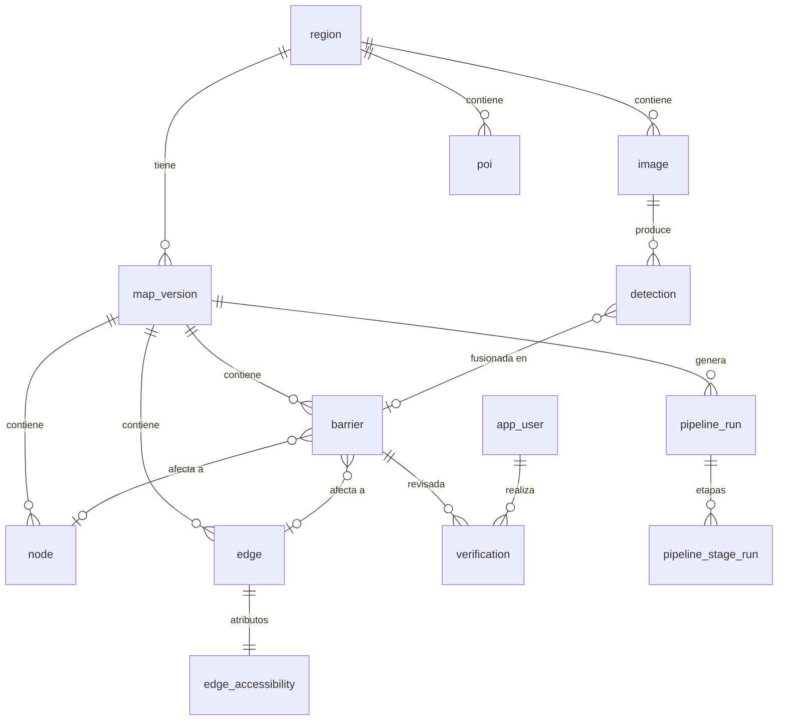

# 03 — Modelo de datos (PostgreSQL 16 + PostGIS + pgRouting)

Convenciones: claves `id` tipo `uuid` (salvo nodos/tramos del grafo, que usan `bigint` porque pgRouting lo requiere), `created_at`/`updated_at timestamptz`, geometrías en **EPSG:4326**; cálculos métricos con `geography` o transformando a la zona UTM de la región (`region.utm_srid`). Todas las migraciones con Alembic.

## 1. Diagrama entidad-relación



## 2. Tablas

### region
| Columna | Tipo | Notas |
|---|---|---|
| id | uuid PK | |
| slug | text UNIQUE | `campus-piloto` |
| name | text | |
| boundary | geometry(MultiPolygon,4326) | índice GIST |
| utm_srid | int | p. ej. 32618 |
| config | jsonb | fuentes de imágenes, fuente de elevación, umbrales (ver §3) |
| published_version_id | uuid FK → map_version NULL | versión usada para rutas |
| is_active | bool | |

### map_version
| id uuid PK | region_id FK | number int (incremental por región) | status text CHECK IN ('draft','published','archived') | created_at | published_at | notes text |

### node (nodos del grafo peatonal)
| Columna | Tipo | Notas |
|---|---|---|
| id | bigint PK | generado (secuencia) |
| map_version_id | uuid FK | |
| osm_id | bigint NULL | |
| geom | geometry(Point,4326) | GIST |
| elevation_m | real NULL | |
| kind | text | `junction`, `crossing`, `curb`, `entrance`, `elevator`, `other` |
| tags | jsonb | etiquetas OSM relevantes (`kerb`, `kerb:height`, `wheelchair`...) |

### edge (tramos del grafo, dirigidos implícitamente: source→target)
| Columna | Tipo | Notas |
|---|---|---|
| id | bigint PK | |
| map_version_id | uuid FK | |
| source / target | bigint FK → node | |
| osm_way_id | bigint NULL | |
| geom | geometry(LineString,4326) | sentido source→target |
| length_m | real | |
| kind | text | `sidewalk`, `footway`, `path`, `crossing`, `steps`, `ramp`, `elevator`, `road_shoulder` |
| tags | jsonb | `surface`, `smoothness`, `width`, `incline`, `wheelchair`... |
| slope_pct / max_slope_pct | real NULL | salida de la etapa `elevation`, con signo source→target; NULL si el MDE no cubre el tramo |
| slope_source | text NULL | `dem`, `dem_lowres` (celda > 10 m, baja la confianza) u `osm_incline` (la etiqueta gana al MDE) |
| overrides | jsonb | atributos medidos en campo (`PATCH /edges/{id}/accessibility`); tienen prioridad sobre todo lo calculado y sobreviven a recalcular |

### edge_accessibility (1:1 con edge, recalculable)
| Columna | Tipo | Notas |
|---|---|---|
| edge_id | bigint PK FK | |
| slope_pct | real | pendiente con signo en sentido source→target (de MDE, sobrescrita por `incline` OSM o verificación) |
| max_slope_pct | real | máxima en ventanas de 10 m |
| cross_slope_pct | real NULL | |
| width_m | real NULL | |
| surface_class | smallint | 0 excelente … 4 impracticable (ver §4) |
| has_steps | bool | |
| max_step_height_cm | real NULL | |
| curb_ramp_start / curb_ramp_end | text | `yes`, `no`, `unknown`, `n/a` |
| obstacle_level | smallint | 0 ninguno, 1 reduce ancho, 2 bloquea |
| sidewalk_missing | bool | |
| data_confidence | real 0–1 | confianza agregada de los datos del tramo |
| verified | bool | todas las barreras del tramo verificadas o tramo revisado sin barreras |
| coverage | text | `imagery`, `osm_only`, `none` |
| status | text | `accessible`, `caution`, `inaccessible`, `unknown` (para la capa visual, calculado con el perfil "manual estándar") |
| computed_at | timestamptz | |

### image
| Columna | Tipo | Notas |
|---|---|---|
| id | uuid PK | |
| region_id | uuid FK | |
| provider | text | `mapillary`, `upload`, `streetview` |
| external_id | text NULL | UNIQUE(provider, external_id) |
| captured_at | timestamptz | |
| geom | geometry(Point,4326) | posición de cámara |
| heading_deg | real NULL | 0 = norte |
| pitch_deg | real NULL | |
| fov_deg | real NULL | |
| is_panorama | bool | |
| camera_height_m | real | por defecto 2.0 (Mapillary vehículo/persona: ajustable) |
| storage_key | text NULL | ruta en S3 (si la licencia permite almacenar) |
| width_px / height_px | int | |
| license | text | `CC-BY-SA-4.0`, `own`, `google-tos` |
| attribution | text NULL | autor Mapillary |
| privacy_blurred | bool | |
| status | text | `pending`, `processed`, `failed`, `skipped` |

### detection (observación del modelo)
| Columna | Tipo | Notas |
|---|---|---|
| id | uuid PK | |
| image_id | uuid FK | |
| model_version | text | p. ej. `det-v0.3.1` |
| class | text | ver taxonomía en `05-pipeline-vision.md` |
| score | real | 0–1 |
| bbox | int[4] | x1,y1,x2,y2 en píxeles |
| mask_key | text NULL | si hay segmentación |
| attributes | jsonb | p. ej. `{"step_count": 3}` |
| geom | geometry(Point,4326) NULL | posición estimada |
| geo_error_m | real NULL | |
| barrier_id | uuid FK NULL | |
| crop_key | text NULL | recorte en S3 |

### barrier (hecho fusionado)
| Columna | Tipo | Notas |
|---|---|---|
| id | uuid PK | |
| map_version_id | uuid FK | |
| class | text | |
| severity | text | `critical`, `major`, `minor` |
| geom | geometry(Point,4326) | |
| edge_id | bigint FK NULL | |
| node_id | bigint FK NULL | |
| attributes | jsonb | altura de escalón, número de escalones, ancho libre... |
| confidence | real | confianza agregada |
| n_observations | int | |
| source | text | `vision`, `osm`, `manual` |
| verification_status | text | `unverified`, `confirmed`, `rejected`, `corrected` |
| representative_detection_id | uuid NULL | para mostrar la foto |

### verification
| id uuid PK | barrier_id FK | user_id FK | action text (`confirm`,`reject`,`correct`,`create`) | before jsonb | after jsonb | comment text | created_at |

### poi
| id uuid PK | region_id FK | name text | category text (`building`,`entrance`,`toilet`,`parking`,`service`) | geom Point | accessible_entrance bool | tags jsonb | search_vector tsvector (GIN) |

### app_user (solo panel admin)
| id uuid PK | email citext UNIQUE | password_hash text | role text (`admin`,`verifier`) | is_active bool | token_version int (va en cada JWT; al incrementarlo se revocan las sesiones) |

### pipeline_run / pipeline_stage_run
- `pipeline_run`: id, region_id, map_version_id, requested_by, status (`queued`,`running`,`succeeded`,`failed`,`cancelled`), params jsonb, started_at, finished_at.
- `pipeline_stage_run`: id, pipeline_run_id, stage (`import_osm`,`elevation`,`ingest_images`,`detect`,`geolocate`,`fuse`,`compute_attributes`,`build_routing_graph`), status, progress real, stats jsonb, error text, started_at, finished_at.

### routing_edge (vista materializada por versión)
Columnas que pgRouting necesita + atributos para el costo:
`id, source, target, length_m, slope_pct, max_slope_pct, cross_slope_pct, width_m, surface_class, has_steps, max_step_height_cm, curb_ramp_start, curb_ramp_end, obstacle_level, sidewalk_missing, data_confidence, verified, kind, geom`, filtrada por `map_version_id`. Los tramos son bidireccionales: el sentido inverso usa `-slope_pct` (ver `06-enrutamiento.md`).

## 3. `region.config` (JSON Schema resumido)

```json
{
  "image_sources": [
    {"provider": "mapillary", "enabled": true, "min_captured_at": "2021-01-01", "max_images": 20000},
    {"provider": "upload", "enabled": true},
    {"provider": "streetview", "enabled": false}
  ],
  "elevation": {"source": "raster_file", "path": "s3://dem/campus.tif"},
  "osm": {"source": "overpass", "buffer_m": 100},
  "thresholds": {"detection_min_score": 0.35, "fusion_radius_m": 4.0, "snap_max_m": 8.0}
}
```

`osm.source`: `overpass` o `file` (con `path`). `elevation.source`: `raster_file` (con `path`), `flat` (`elevation_m`) o `none`. Un `path` es `s3://bucket/clave` o una ruta relativa a `REDUC_DATA_DIR`; no se aceptan rutas fuera de ese directorio.

## 4. Clases de superficie
| surface_class | Ejemplos |
|---|---|
| 0 | asfalto/concreto liso |
| 1 | adoquín liso, baldosa en buen estado |
| 2 | adoquín irregular, grava compacta, grietas menores |
| 3 | grava suelta, césped, tierra, baldosas rotas, grietas grandes |
| 4 | arena, barro, escombros, huecos |

## 5. Índices obligatorios
GIST en todas las geometrías; `edge(map_version_id)`, `edge(source)`, `edge(target)`; `detection(image_id)`, `detection(barrier_id)`; `barrier(map_version_id, verification_status)`; `image(region_id, status)`; GIN en `poi.search_vector`.

## 6. Datos de prueba (seed)
`scripts/seed_dev.py` crea una región sintética pequeña (cuadrícula de 6×6 calles con escaleras, una pendiente del 12 % y un cruce sin rampa) para pruebas automáticas sin depender de servicios externos.
